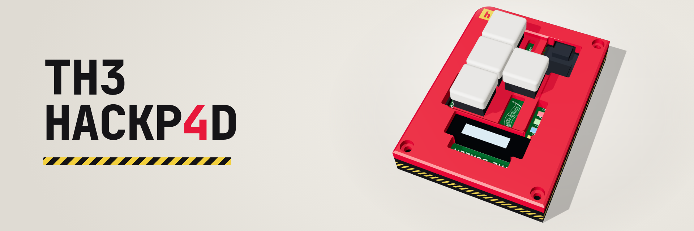
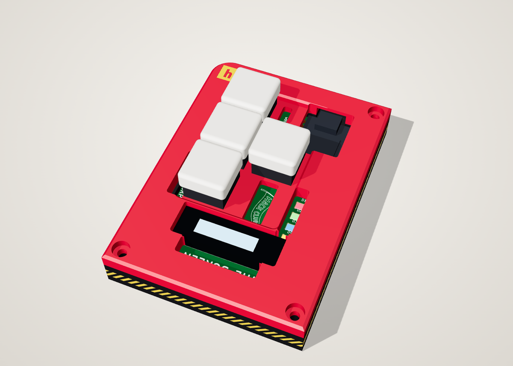
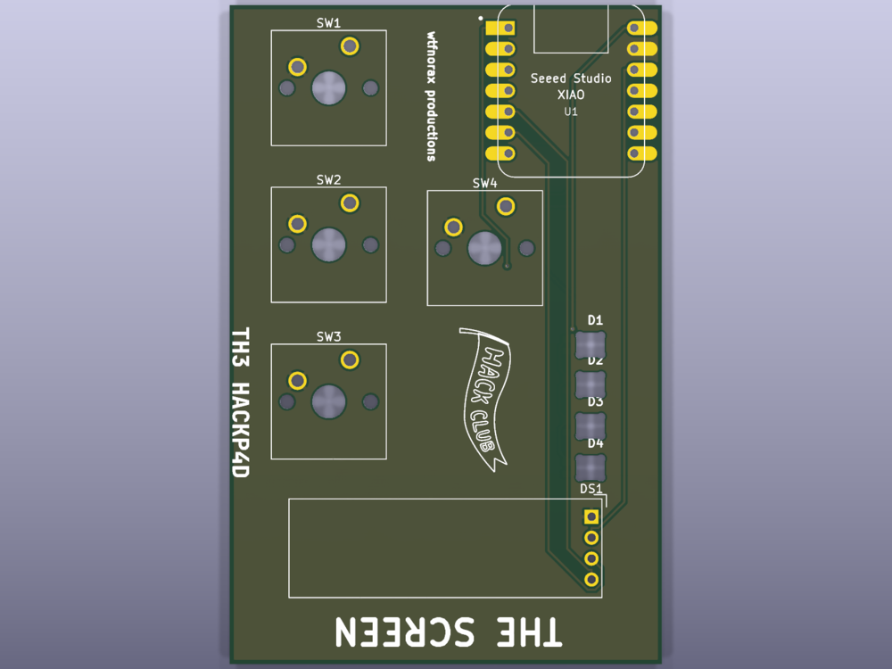
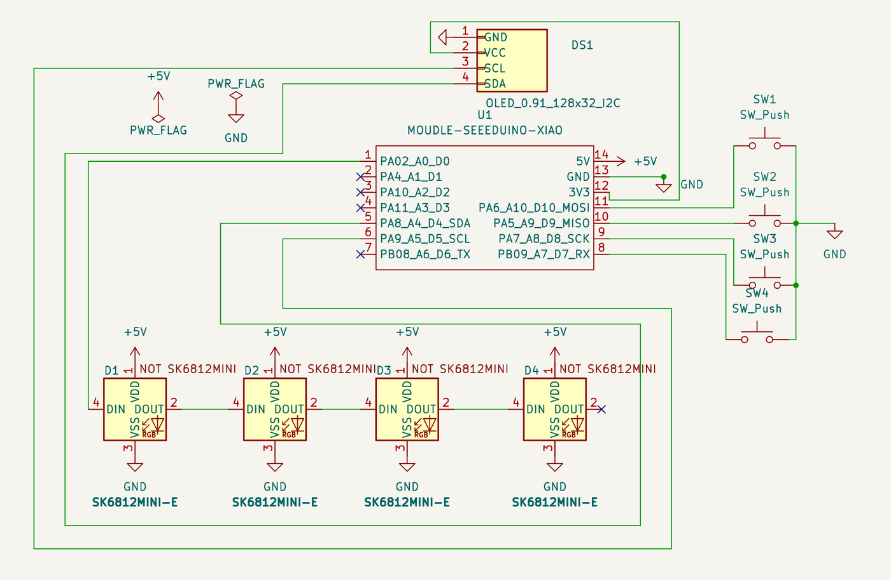

# TH3 HACKP4D

My hackpad for Hack Club. 4 keys, 4 RGB LEDs and a tiny 0.91" OLED, running on a Seeed XIAO RP2040 with KMK.

The whole build, day by day, is in my [journal](journal.md).

Press a key and the LED next to it lights up, and the screen shows the song that's playing on my PC (title and artist). I like seeing the tech, so the case has windows: you can see the XIAO, the LEDs, the Hack Club flag on the PCB and the screen.



## What's in it

- Seeed XIAO RP2040, soldered flat on the front (top right corner)
- 4x MX switches (Gateron Green) with blank smokey keycaps
- 4x SK6812MINI-E LEDs, chained on D0
- 0.91" 128x32 SSD1306 OLED over I2C
- 3D printed case, 73.3 x 100.8 x 17 mm, 3x M3 screws into heat set inserts

All parts with links and prices are in [BOM.csv](BOM.csv).

## PCB

52.5 x 80 mm, 2 layers. The LEDs sit in cut-outs in the board so you can see them through the case.



## Schematic



| | Pin |
|---|---|
| SW1 / SW2 / SW3 / SW4 | D10 / D9 / D8 / D7 (other side to GND) |
| LED data | D0 |
| OLED SDA / SCL | D4 / D5 (address 0x3C) |

## Folders

- `journal.md` my build log
- `PCB/` KiCad project
- `production/` gerbers, the zip is what goes to JLCPCB
- `case/` FreeCAD file, STEP and the STL files for printing
- `firmware/` KMK firmware
- `host/` small script for the PC that sends the song to the screen
- `assets/` logos

## Firmware

1. Flash CircuitPython for the XIAO RP2040 (hold BOOT, plug in, drop the .uf2 on the drive).
2. Copy the `kmk` folder from [kmk_firmware](https://github.com/KMKfw/kmk_firmware) onto CIRCUITPY.
3. Put `neopixel`, `adafruit_displayio_ssd1306` and `adafruit_display_text` from the Adafruit CircuitPython bundle into `lib/`.
4. Copy `firmware/main.py` and `firmware/boot.py` onto the drive, then unplug it and plug it back in.

Right now the keys are play/pause, volume down, volume up and mute. Change the `KEYS` list at the top of `main.py` if you want something else. If the screen shows everything upside down, set `FLIP_SCREEN = True`.

### Song on the screen

The hackpad can't know what's playing by itself, so `host/nowplaying.py` tells it. It uses `playerctl` (Linux), so Spotify, the browser, mpv and so on all work.

```
python3 host/nowplaying.py
```

Leave it running. It finds the hackpad on its own and shows the song while something is playing. Paused = empty screen.

---

wtfnorax productions
